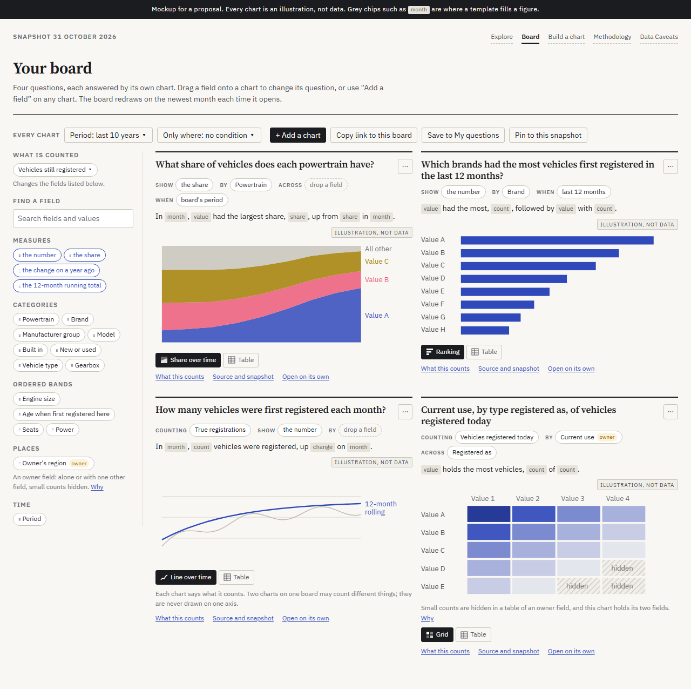
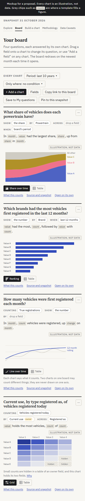
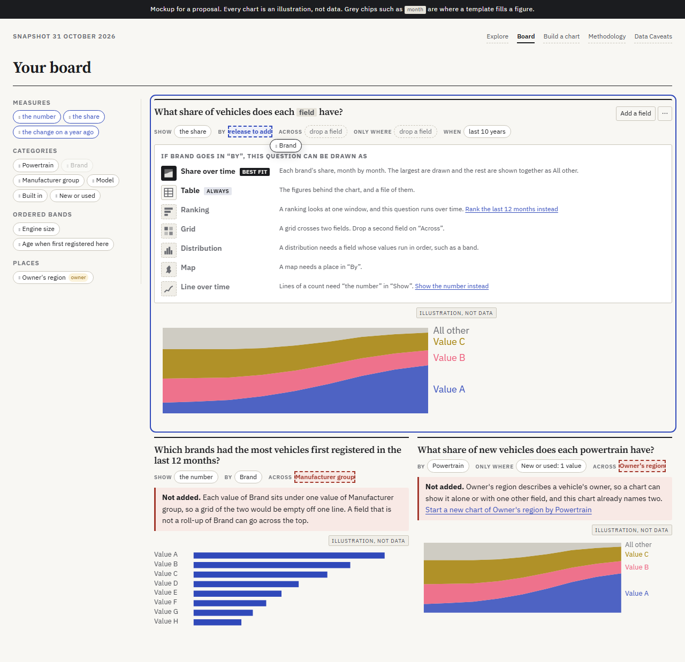
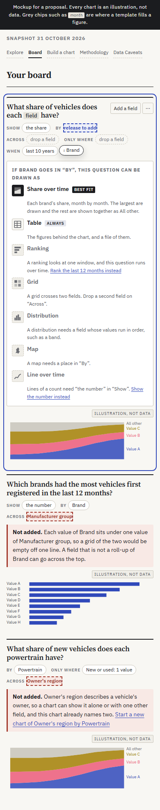
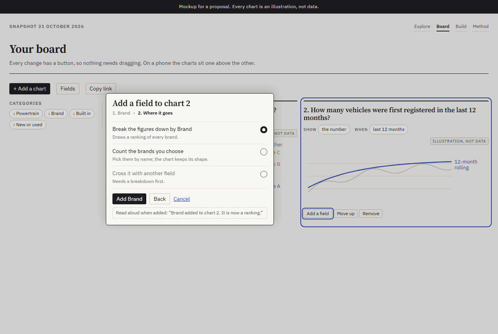
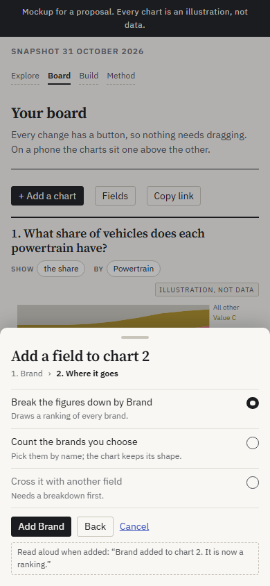

# A board of charts the visitor builds: a proposal

Status: **proposed, parked for the user** (D-143). Nothing on the site changes because of this
document. It answers D-138, the user's end state for the site: "a watered-down Power BI-style visual
analytics page which is fully customisable with the measures from the data set where the user can
build their own charts by dragging and dropping and choose different ways of visualising the data".

Words used here:

- **Board**: a page of several charts that the visitor arranges. In the user's words, the canvas.
- **Chart** (on a board): one question and its answer. Each chart on a board is a Build question,
  the same thing a Build link holds today.
- **Field**: anything the visitor can drag: what is counted, a measure, a breakdown, a condition,
  the period.
- **Rule table**: `config/chart_rules.json`, the one table that says which of the six shapes fit a
  question, best first (D-100).

## In short

1. Build a **board beside Build**, not in place of it. Each chart on a board is a Build question, and
   "Open on its own" takes it to the Build page, which stays as the one-chart view.
2. Start small: first an **"Add to board"** button on every Explore chart and Build question and a
   board page that lays them out, with no dragging. Field dragging, the shape list and board-wide
   settings come after, one pull request each.
3. The **rule table becomes the chart picker**: a chart offers the shapes that fit, best first, and
   always a table. Shapes that do not fit are listed greyed with the reason and a one-click nearest
   question. They are never drawn.
4. **Every invariant holds.** Two lines of "How every page reads", the Explore and Build line at the
   top of CLAUDE.md and one line of Shapes would be reworded so they apply to each chart on a board
   (section 4). The wording is proposed here; nothing is changed without the user's approval.
5. The engine comes first: the narrative engine (package H) so that every chart has its answer
   sentence, and the first-load speed, which a board makes harder (section 3.6).

---

## 1. What the board is

A page of several charts that the visitor builds. The mockups are in section 6.

**On the left, the fields.** They are listed under the headings the data map already gives them:
what is counted (a dataset), the measures, then the fields by kind (categories, ordered bands,
places, time). A field that describes the owner carries an "owner" mark and one line on how it may be
shown (section 3.4). The list is read from the data map and the manifest, so a field or dataset added
to them appears here with no change to the page. This is what makes "pull and build new data sets into
the site" (D-138) a pipeline task rather than a page change.

**Each chart has slots** that hold a question's parts, in the words Build already uses:

| Slot | What it holds | Build today |
|---|---|---|
| Counting | the dataset: vehicles still registered, true registrations, vehicles registered today | "Counting" |
| Show | the measure: the number, the share, the change on a year ago, the 12-month running total | "Show" |
| By | the first breakdown | "by" |
| Across | a second breakdown, crossed with the first | the second breakdown (D-114) |
| Only where | conditions: values of other fields | "Only vehicles where" |
| When | the period | the time row |

Dropping a field on a slot changes that chart's question, and the chart redraws. Dropping a field on
the chart itself, not on a slot, puts it in the first empty slot that fits its kind.

**The board.**

- Charts are added ("+ Add a chart", or "Add to board" from Explore or Build), removed, reordered and
  resized.
- Sizes are a third, a half or the whole width of a twelve-column grid, never a free pixel size. Fixed
  sizes keep the link short, keep every chart legible, and give the keyboard a "Wider" and "Narrower"
  button instead of a resize handle. On a phone every chart is the full width, one above the other.
- **Every chart** settings at the top: a period and conditions that apply to each chart on the board
  unless a chart sets its own.
- **The whole board is a link.** The address holds each chart's question, written as Build already
  writes it (`build.measure=…&build.by=…`), and its size, in order. A link of six charts is a few
  hundred to a few thousand characters (an estimate, not measured), well within what browsers and
  chat apps carry.

**Words a visitor types never travel in the link.** A visitor may name a board, as "My questions"
lets them name a question today (D-125), but the name stays in their own browser. A board opened from
a link has a heading the site writes from its charts. Without this rule, anyone could send a link to
this site's address that shows their own sentence as a heading over real charts. Chart titles are
written from the question by the site, never typed by the visitor.

**Dragging is never the only way.** Every drag has a button, and the buttons work from the keyboard
and are announced to a screen reader:

| By dragging | Without dragging |
|---|---|
| Drag a field onto a chart | "Add a field" on the chart opens a dialog: pick the field (with a search box), then where it goes. Each choice says what the chart becomes ("Draws a ranking of every brand"); a choice that cannot be made is shown greyed with its reason (mockup 3) |
| Drag a field off a chart | Each field on a chart is a button with "Remove" |
| Drag a chart to a new place | "Move up" and "Move down" on the chart |
| Drag a chart's corner | "Wider" and "Narrower" (not shown on a phone, where every chart is full width) |
| Drag a field onto the "Every chart" bar | "Period" and "Only where" buttons in the bar |

After each change a polite live region says what happened: "Brand added to chart 2. It is now a
ranking." On a phone the field list opens as a sheet from the bottom of the screen, and the same
dialog does the rest (mockup 3).

How dragging is built (the platform's own drag events work poorly on touch screens, so it would be
pointer events written here, or a widely used React drag library with keyboard support built in, such
as dnd-kit) is a decision for the pull request that adds it. A library is a new dependency and gets its
own decision record; its licence, size and upkeep are not checked here.

## 2. The rule table as the chart picker

**Today.** A question is reduced to a few facts: the kind of measure, the kind of the first field, how
many values it has, one window or over time, how many values were picked, the kind of a second field,
and whether the dataset has one period or several. The rule table is read from the top; the first rule
that matches gives the shapes that fit, best first. Build draws the first and lets the visitor switch
to the others. A table of the figures is always available.

**On a board.** Under each chart, the shapes that fit, best first, and "Table" always. While a field is
held over a slot, the chart shows what the question would become (mockup 2):

- the shapes that would fit, the best marked "best fit";
- "Table", marked "always";
- each shape that would not fit, greyed, with a sentence saying what it needs and, where one change
  would make it fit, a button that makes that change ("Rank the last 12 months instead").

A greyed shape is never drawn. That keeps CLAUDE.md's "they never get a shape that does not fit"
(section 4 proposes the wording that allows listing them).

**How the reason is found, with no field named in code.** For a shape the question does not fit, look
at the rules that list that shape. For each, count the facts the question would have to change to match
it, and check that the changed question would really reach that rule (no earlier rule catches it first).
The rule with the fewest changes is the nearest question. The sentence comes from a template for each
fact, for example "A ranking looks at one window, and this question runs over time." or "A map needs a
place in “By”." The templates live in config, name no value, figure or year, and are held to the
banned-word list (`config/narrative/rules.json`) as every template is. This is a reading of the
table the code already has. It adds no rule.

I checked the examples in the mockups against the table by hand. The share by Brand over time matches
`share_by_category` (lines of shares). Changing the period to one window would match `ranking` (the
league). Changing the measure to the number would fall to the last rule (a line).

**When a drop makes no shape fit.** With today's table this cannot happen through the shapes alone:
the last rule matches every question. What can happen is that the question is refused before any
shape is asked: a share with no breakdown, a total of a dataset with one period, two fields that are a
roll-up of one another (`builder.cannot_cross` in `config/presets.json`: a brand sits under one
manufacturer group), a field that describes the owner in a table larger than the rule allows, or a
field the dataset does not carry. On a board such a drop is **refused at the moment of the drop**:

- the slot turns red while the field is held over it;
- if the field is dropped, the chart keeps its last question;
- a sentence from a template says why ("Each value of Brand sits under one value of Manufacturer
  group, so a grid of the two would be empty off one line.");
- where there is a nearest question that fits, it is offered as one button ("Start a new chart of
  Owner's region by Powertrain").

The reasons Build gives today after the fact become reasons given at the drop. The checks are the
same (`src/lib/resolve.ts`), so a board cannot ask anything a Build link cannot.

**Are six shapes enough?** For the questions this data can honestly answer, yes, with a few visual
variants. A variant is chosen by config inside a shape and is not a new shape (CLAUDE.md, Shapes), but
each is still a decision.

| What Power BI-style tools offer | Here | Why |
|---|---|---|
| Line, area | `trend`, `mix` | already here |
| Bar, column (ranked) | `league` | already here |
| Heat map, pivot grid | `matrix` | already here |
| Map | `geo` | already here |
| Histogram | `distribution` | already here |
| **Small multiples** (one small chart for each value) | proposed variant of `trend` and `mix` | the clearest way to compare many values over time on a small chart |
| **Stacked columns of counts** by month or year | proposed variant of `trend` | shows the total and its parts at once; a share is still `mix` |
| **A single figure** ("card", "KPI") | the chart's answer sentence and figure shown without a chart | "The answer first" already gives every chart a sentence and a figure; a board may show that alone. No new renderer |
| **Slope** (each value's rank in two windows) | a variant of `league`, which already draws the change in rank | proposed only if visitors ask for it |
| Pie, donut | not offered | a share of a whole is `mix`; a pie of many values cannot be read |
| Scatter (two measures, one dot per value) | **would be a seventh shape** | needs a question with two measures, which no question can state today. Not proposed |
| Treemap, waterfall, gauge, funnel | not offered | no question in this data needs them that a ranking or a line does not answer more plainly |

## 3. How each existing piece carries over

### 3.1 Saved questions and "My questions"

A saved question is a Build link kept in the browser (D-125, `localStorage`, key
`nzta.my_questions`). A board is a list of such links with sizes, so it is kept the same way: the
saved list holds questions and boards side by side, each with its name, the time it was saved, and
"Export as links". A saved board redraws on the newest month when it is opened, with nothing for the
visitor to do (CLAUDE.md, point 9), because each chart's question leaves the month out unless it is
pinned.

### 3.2 Pinned snapshots

A pin today is a month in the link (`build.snapshot=YYYY-MM`). Where the deploy keeps that
snapshot's files, a pinned link reads that snapshot's own figures (D-131); otherwise the page says
plainly what it shows instead (the pin sentences in `builder.notices`). On a board:

- **A board is pinned as a whole** ("Pin to this snapshot" in the board's bar), because a board is
  usually quoted as one page. The pin is written into each chart's question, so each chart behaves
  exactly as a pinned Build link does, and shows its own pin sentence where it differs (a line that
  always runs to the newest month, for instance).
- A single chart can be pinned on its own and keeps that pin when the board's pin is removed. This
  could wait until someone asks for it.

### 3.3 The phrase templates (invariant 8)

- **Each chart's answer** is the sentence its question gets on Build, from the same templates.
- **The board's summary**, at the top, is each chart's answer sentence in board order, under a heading
  the site writes ("Your board: four questions"). Nothing else.
- **No sentence compares two charts.** It would need facts across charts that no template has, and
  two charts may count different things (vehicles still registered and true registrations, which are
  never put on one chart). A later decision could add one.
- Refusals and greyed-shape reasons are templates in config, held to the same lint.
- A sentence that cannot be filled, or that rests on a hidden value, is dropped, as now.

### 3.4 The small-cell rules (owner fields)

The rule (D-096, D-127, D-135): a field that describes the owner is published only in a table of one
field (a slice) or two (a pair), with counts under the minimum hidden. A second rule stops a total from
giving a hidden cell away. The site draws such a table with its hidden cells hidden: the word "hidden"
on a hatch, never a number, and never counted as zero (D-139).

On a board:

- A chart over an owner field reads its slice or its pair, as Build does. The published files hold no
  larger table, so there is nothing else it could read.
- **A drop that would break the rule is refused at the drop**: a third field, a condition beside an
  owner field, or an owner field dropped on a chart that already names two fields (mockup 2, the third
  chart). The sentence names the field, says it describes the owner and that a chart shows it alone or
  with one other field, and offers a new chart that keeps to the rule. That a condition counts as a
  field here is my reading of D-096 and D-130 item 3, to confirm.
- Hidden cells are drawn hidden on a board exactly as on Build (mockup 1, the fourth chart).
- Several charts on one board do not show more than the files show. A board draws published files
  only, and anyone can download and combine those. The build's check does not compare tables with
  one another (`docs/CUBE_SCHEMA.md`, the audit note), and a board does not change that.

### 3.5 Definitions, sources and snapshot dates

Each chart has three links under it: **What this counts** (the dataset's definition and each field's
definition from the data map, with its one-line note), **Source and snapshot** (the source, its
attribution, the snapshot date, the pin) and **Open on its own** (the chart on the Build page, with its
file of figures). Every figure stays one step from its definition, its source and its snapshot date
(CLAUDE.md, point 6). The snapshot date is also in the page's top line, as on Explore and Build now.

### 3.6 First load

A board loads more than one question, so it needs more data than Build. The plan:

- **Charts load when they come into view.** A chart below the screen does not download anything
  until the visitor scrolls to it.
- **A file is fetched once per page.** Charts that read the same fact-table column share the
  download (every chart reads the count column).
- Explore already loads its first chart first (D-099), and a board would do the same.

**What a board downloads (an estimate).** The fact table is published as one file per column, and a
question downloads the columns it names (D-058). I measured the column files of the local build of the
2026-10 snapshot (`registrations_surviving`, 641,618 rows, built 2026-11-14):

| Column | Bytes |
|---|---|
| count (`n`) | 378,842 |
| month | 11,044 |
| powertrain | 8,202 |
| brand (`make`) | 108,914 |
| new or used (`import_status`) | 52,749 |
| age when first registered here | 290,734 |
| model | 282,266 |
| built in | 112,458 |
| the whole table, 15 columns | 1,768,391 |

- A board of six charts over that dataset naming those six fields (share by powertrain, a brand
  ranking, a grid of powertrain by new or used, the age distribution, a model ranking, built in over
  time) needs the eight columns above: **1,245,209 bytes, about 1.2 MB** if every chart is scrolled
  into view. At the phone profile's 1.6 Mbps, the download alone is **about 6 seconds**. That is an
  estimate from file sizes, without latency, the page's code or the processor.
- The worst case, every column of the table, is 1,768,391 bytes, **about 9 seconds** at that speed
  (estimate).
- The build on `main` is larger: its table has 755,586 rows on the same pull (`docs/CUBE_SCHEMA.md`)
  and more columns, so these figures are a floor.
- For comparison, measured (D-099): a Build question naming three fields reaches its first answer in
  6.58 s on the phone profile, and the target of 3 s is not met today. A board's first chart would be
  close to that if the first screen holds one or two charts (estimate). The rest arrive as the visitor
  scrolls.

### 3.7 The query service (D-091)

The service is specified and prototyped, and is not hosted (hosting it costs money, so it is the
user's decision). It answers a structured question with aggregates only. Measured locally (a floor,
not a forecast), it cut an eight-field question's download from 1,671 KB to 531 KB and its first answer
on the phone profile from 11.6 s to 5.0 s. For a board it matters in two ways:

- **Speed**: each chart asks for its few figures instead of downloading whole columns.
- **Reach**: fields the static fact table cannot carry without growing too large (more crossings, a
  model by region) become askable, still under the data map's privacy classes and the small-cell rule.

The board works without it, on static files, as Build does. When the service is down, the board falls
back to the static files where they can answer and says so plainly where they cannot (invariant 6).

### 3.8 Events and Explore

- **Events** stay scoped to each chart's question, as on Build. On a chart a third of the width, the
  markers are numbered and the list sits under a "Events" disclosure.
- **Explore's charts become starting boards.** Each section of Explore today ("The core shifts",
  "Market structure", "True registrations") becomes a board in config, made of the existing presets.
  The Explore page itself stays as the place that sets the stage, and each section gets "Open as a
  board". A starting board is a JSON object in config, as a preset is (invariant 2).

## 4. Which CLAUDE.md rules would change

Changes to CLAUDE.md need the user's approval (work order §3, "Changing CLAUDE.md's invariants,
non-goals or the shapes"). The wording below is proposed; nothing is changed.

| Now (quoted exactly) | Proposed | Why |
|---|---|---|
| "Two surfaces: **Explore** (question-titled charts, each a starting point) and **Build** (a question builder: any measure, any values of any dimension, any filters, any period, answered from a precomputed fact table, D-058, D-059)." | "Three surfaces: **Explore** (question-titled charts and starting boards, each a starting point), **Build** (one question and its chart: any measure, any values of any dimension, any filters, any period, answered from a precomputed fact table, D-058, D-059) and **Boards** (a page of Build questions the visitor arranges, D-143)." | A board is a new surface. Build stays as the view of one chart. |
| "A visitor asks one question and gets one clear answer, the evidence for it, and the freedom to dig further. Nothing is on the page that does not bear on the question (D-062)." | "A visitor asks one question and gets one clear answer, the evidence for it, and the freedom to dig further. Nothing is on a chart that does not bear on its question, and nothing is on a board that the visitor or a starting board did not put there (D-062, D-143)." | On a board the page holds several questions. Each chart keeps the rule. |
| "1. **The answer first.** A sentence and a figure, then one chart." | "1. **The answer first.** For every chart: a sentence and a figure, then the chart." | The same rule, per chart. |
| "2. **One question per view.**" | "2. **One question per chart.** A board is several charts, each answering one question." | The rule moves from the page to the chart. |
| "Where more than one shape fits the question, the visitor may switch among those that fit; they never get a shape that does not fit, and there is no seventh." | "Where more than one shape fits the question, the visitor may switch among those that fit; they never get a shape that does not fit, and there is no seventh. A shape that does not fit may be listed, greyed, with the reason and the nearest question it would fit." | Listing a shape is not drawing it. The new sentence says so, so a reader does not take the greyed list for a breach. |
| "10. The full engine: Build over every field the map makes public, with saved questions that update themselves." | "10. The full engine: Build over every field the map makes public, with saved questions and boards that update themselves." | A board is a saved list of questions. |

**What holds unchanged:**

- "3. **Only what bears on the question.**", "5. **Defaults do the work.**" and the rest of "How
  every page reads" hold as written, applied to each chart. A new board opens with starting charts, and
  each chart opens with the shape the rule table puts first, so a visitor still needs to change
  nothing.
- **All eight invariants hold, with no change of wording:**
  1. Nothing domain-specific in code: the field list, slots and reasons are read from the data map,
     the rule table and config.
  2. Charts are data: a starting board is a JSON object made of presets.
  3. Events are append-only data: unchanged.
  4. Every dimension derivable: the board adds no dimension.
  5. The pipeline fails loudly: unchanged.
  6. The browser never sees a vehicle row: a board reads the same aggregates as Build.
  7. No measurement artefact as market behaviour: each chart keeps its notes and events.
  8. Words are data: every sentence on a board comes from a template; the visitor's own words stay in
     their browser.
- The six shapes and AGENTS.md hard rule 1 hold. The variants in section 2 are config inside a
  shape. The scatter, which would be a seventh shape, is not proposed.
- The non-goals hold. A board the visitor makes is not hand-written commentary by the site, and the
  rule that visitor text never travels in a link keeps it that way.

## 5. Options and the recommended path

| Option | What it is | For | Against |
|---|---|---|---|
| **A. A board replaces Build** | Build's form becomes the editor of a chart on a board; the Build page goes | one surface; the user's end state at once | the biggest change first; every Build link and saved question must be carried over in one step; a link to one chart loses its plain page |
| **B. A board beside Build** (recommended) | Build stays as one chart; a board is a page of Build questions; Explore's sections become starting boards | each chart is a Build question, so links, saved questions, pins, rules and checks carry over unchanged; can be built in small steps; easy to undo | two places to edit a question (a chart on a board, and Build), kept the same by sharing one editor |
| **C. "Add to board" first** | a button on every chart that adds it to a board page; arrange, resize, remove; no field dragging | smallest step; shows whether visitors use boards before the costly part is built | not yet the drag-and-drop page the user described |

**Recommendation: B, reached through C.** C is the first step of B, so nothing is thrown away. Once
the board has all that Build has, retiring Build's form (A) is a small choice for later, not a
rewrite.

**The staged path, one reviewable pull request each:**

1. **The board in code, no page.** Read and write a board link (a list of Build questions with
   sizes); every chart's question goes through the checks a Build link goes through; a limit on the
   number of charts, in config. Tests only.
2. **"Add to board" and the board page.** The button on Explore and Build; the board page draws each
   chart with the existing panel, lazily; Move up, Move down, Wider, Narrower, Remove; "Copy link";
   boards kept beside saved questions.
3. **Editing a chart on the board, without dragging.** "Add a field" with its dialog, fields as
   removable buttons, the announcements.
4. **The shape list with reasons.** The nearest-rule reading of the rule table, the reason
   templates in config, the lint, tests.
5. **Dragging**, with pointer, touch and keyboard giving the same results; the library decision if one
   is used.
6. **"Every chart" settings**: a period and conditions for the whole board.
7. **Starting boards**: Explore's sections as boards in config.
8. **Variants** (small multiples, stacked count columns, the single figure), each with its own
   decision.
9. **Pins on boards**, as section 3.2.

**What the engine needs before a board is worth building:**

- **The narrative engine** (package H, `docs/NARRATIVE.md` not yet written). Without it a chart on a
  board has an answer sentence where a preset has one written in config, and none for most questions
  a visitor builds. A board of charts without answers falls short of "The answer first".
- **Labels as data** (package H), so every value a chart shows has its display label.
- **The search box for values** (package H), which "Only where" needs.
- **First-load speed**: the 3-second target is not met for one question today (D-099). A board loads
  more, so either the query service (a cost, the user's decision) or a lighter form of the static
  files is needed before boards are the main way in.
- **The owner rule end to end**: owner fields reachable in Build under the rule (D-139 did this for
  "Current use"), so the board inherits it rather than building its own.

## 6. Mockups

Static HTML in `docs/brief/canvas/`, drawn with the site's tokens (paper, ink, palette, Source Serif
and IBM Plex Sans). Every chart in them is an illustration: the curves are made up, the axes carry no
numbers, the series are "Value A", "Value B" and so on, and each is stamped "Illustration, not data".
Where a sentence would hold a figure, a grey chip names the placeholder (`month`, `share`, `count`).
The field names and dataset names are the site's own. Screenshots were taken headless at 1280 and
390 px, light theme (the site has no dark theme).

### Mockup 1: a board of four charts, the field list on the left

A share over time, a ranking, a line of true registrations and a grid of an owner field with its
hidden cells hidden. Each chart shows its slots, its answer sentence, the shapes that fit and its three
links. The board's bar holds the "Every chart" settings and the board's own links.

At 390 px the charts sit one above the other, the field list is behind a "Fields" button, and each
chart keeps all its parts.

### Mockup 2: the moment a field is dropped

"Brand" is held over the "By" slot of a chart showing the share. The chart lists what the question
would become: "Share over time" (best fit), "Table" (always), and the five shapes that would not fit,
greyed, each with its reason and, for two of them, the one change that would make it fit. Below, two
refused drops: a roll-up pair (Brand across Manufacturer group) and an owner field that would make a
chart of three fields.

### Mockup 3: adding a field without dragging

"Add a field" on chart 2 opens a sheet on a phone and a dialog at desktop width. Step 1 picks the
field (here, Brand); step 2 says where it goes, what each choice draws, and why one choice is greyed.
The keyboard focus ring is on the button that opened it. The line at the bottom is what a screen
reader hears when the field is added.

## 7. Questions for the user

1. **Which path?** (a) A board beside Build, reached through "Add to board" first (section 5,
   B through C); (b) a board that replaces Build from the start (A); (c) "Add to board" only, with no
   field dragging. **Recommended: (a).** If unanswered: nothing is built until package H is done and
   the user says to start; then step 1 of (a).
2. **Shapes that do not fit.** (a) Listed greyed under each chart with the reason and a one-click
   nearest question, never drawn, with the one-sentence addition to CLAUDE.md's Shapes in section 4;
   (b) hidden, as Build does today; (c) drawable with a warning, which breaks "they never get a shape
   that does not fit". **Recommended: (a).** If unanswered: (b), today's rule, since (a) needs the
   wording approved.
3. **Which visual variants first?** Small multiples, stacked columns of counts, the single figure
   (the answer sentence and figure alone), the slope; the scatter would be a seventh shape and is not
   proposed. **Recommended: small multiples and the single figure, once boards exist.** If unanswered:
   no variant is built until a visitor's question needs one.

## 8. What this rests on, and what is open

Read in this session: CLAUDE.md, AGENTS.md (hard rules), `docs/brief/WORK_ORDER.md` §3 and package H,
`config/chart_rules.json`, `src/lib/shapes.ts`, `config/presets.json` (`builder`), `config/dimensions.json`,
`config/measures.json`, `config/narrative/rules.json`, `src/styles/site.css`, `src/lib/theme.ts`,
`docs/CUBE_SCHEMA.md`, `docs/QUERY_SERVICE.md` (headings), and D-058, D-091, D-096, D-099, D-100, D-125,
D-127, D-130, D-131, D-135, D-138, D-139 in `docs/DECISIONS.md`. Measured: the fact-table column file
sizes of the local build of the 2026-10 snapshot; the existing Explore and Build pages, screenshotted
headless.

Open:

- Whether a condition counts as a field under the owner rule (section 3.4), my reading, to confirm.
- How dragging is built, and whether a library is added (section 1).
- The limit on charts per board, and whether it is six; a number for config, not decided here.
- A board's own file of figures (today each chart has one, on Build).
- Clicking a value in one chart to make it a condition of the others ("cross-filtering"), which
  Power BI-style tools offer. Not proposed for the first steps; a later decision.
- A measure the visitor defines (D-138 reading 1). The ratio kind of measure could carry "A as a share
  of B" later. Not proposed now.
